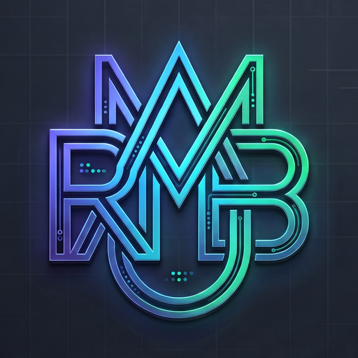

# rambabu-projects-logo

Neon-circuit monogram built from the letters of **RAMBABU**.

> **AI-generated with Google Gemini, directed and selected by Rambabu.** Not hand-drawn. See [ATTRIBUTION.md](ATTRIBUTION.md).



## Versions

| Folder | Contents | Size |
|---|---|---|
| [`main/`](main/) | Square monogram (primary icon) + showcase HTML with icon badge | 1152×1152, 512×512, 180×180 |
| [`v1/`](v1/) | Full logo on circuit-grid background + showcase HTML | 2400×1792 |
| [`original/`](original/) | Untouched Gemini export (with visible sparkle) + Gemini's HTML badge code | 2400×1792 |
| [`docs/`](docs/) | Before/after evidence of the sparkle removal | — |

## Palette (sampled from the image)

| Role | Hex |
|---|---|
| Indigo | `#646ee0` |
| Cyan | `#3ed9f3` |
| Mint | `#35d8a9` |
| Background | `#111217` |

## Integrity

`SHA256SUMS` lists the SHA-256 of every asset. To verify:

```bash
shasum -a 256 -c SHA256SUMS
```

The v1.0.0 GitHub release attaches the PNGs and `SHA256SUMS` as release assets. Its server-side publish time is the public date record.

## Watermark note

The visible Gemini sparkle was removed from `main/` and `v1/` by inpainting. Google's invisible **SynthID** watermark remains in all images.

## Licence

No licence is granted. All rights reserved, to the extent any exist; see the rights notice in [ATTRIBUTION.md](ATTRIBUTION.md).
